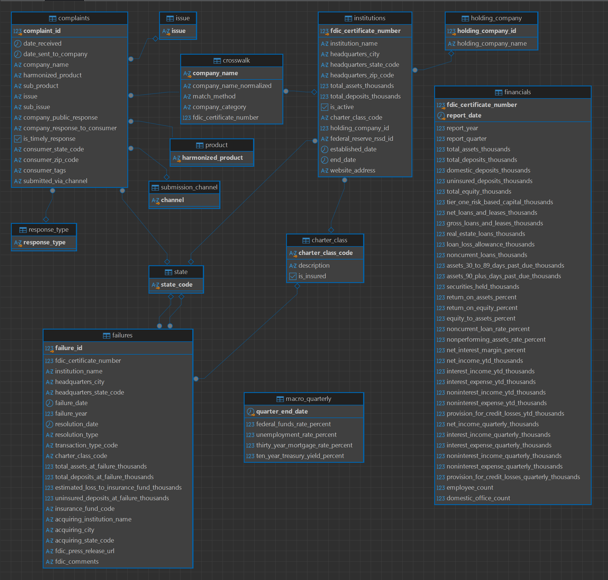

# Schema Documentation

Model and design reference for the Bank Health capstone database.

## Table of Contents

1. [Diagrams](#1-diagrams)
   - [1.1 Database Schemas](#11-database-schemas)
   - [1.2 Power BI Model](#12-power-bi-model)
2. [Layers](#2-layers)
3. [Design Decisions](#3-design-decisions)
4. [Tables](#4-tables)
5. [Date Dimensions](#5-date-dimensions)
6. [Mart Objects](#6-mart-objects)
7. [Indexes](#7-indexes)
8. [Validation](#8-validation)
9. [What Lives in DAX and Why](#9-what-lives-in-dax-and-why)
   - [9.1 Thin DAX Wrappers Over `fact_concentration`](#91-thin-dax-wrappers-over-fact_concentration)
10. [Concentration Logic in SQL, not DAX](#10-concentration-logic-in-sql-not-dax)
11. [Known Limitations](#11-known-limitations)

---

## 1. Diagrams

### 1.1 Database Schemas

**`clean` - staging layer**

Six tables, one per source file. No foreign keys: the `clean` layer is
deliberately denormalized so that each source file gets its own table with
one rule applied in one place.

**`data_warehouse` - normalized model**

Foreign keys connect facts to lookup tables and to `institutions`. The
`financials` table has no FK on `fdic_certificate_number` (documented under
[Design decisions](#3-design-decisions)).

**`data_mart` - star schema for Power BI**

Three facts (`fact_bank_quarter`, `fact_complaints`, `fact_failures`) share
two conformed dimensions (`dim_bank`, `dim_date_quarterly`) plus a daily date
dimension (`dim_date_daily`) for complaints. `fact_concentration` sits beside
the star as a per-quarter industry aggregate.

**`public` - data quality**

The `data_quality_summary` table lives in `public` because it is a
pipeline-level artifact, not part of the analytical model. It records column
profiles and cleaning rules for every `clean.*` table.

### 1.2 Power BI Model

The report reads only from `data_mart`. Relationships mirror the foreign keys
in the mart schema; two date tables (`dim_date_quarterly`, `dim_date_daily`)
are used because facts live at different grains.

---

## 2. Layers

| Layer | Owner | Purpose |
|---|---|---|
| `clean` | Python (`../src_retired_bc_no_pandas/`) | One table per source file, typed, one rule per column, no cross-table FKs. Rebuilt every run. |
| `data_warehouse` | SQL (`sql/01_data_warehouse/`) | Normalized model with PKs, FKs and lookup tables. Rebuilt every run from `clean`. |
| `data_mart` | SQL (`sql/02_data_mart/`) | Star schema for Power BI. Built from `data_warehouse`, nothing else. |
| `public` | Python (`../src_retired_bc_no_pandas/07_data_quality.py`) | Pipeline-level artifact: `data_quality_summary`. |

`clean` is the staging layer. `data_warehouse` enforces structure. `data_mart`
is shaped for reporting. The Python step must run before the SQL step because
`data_warehouse` reads from `clean`.

---

## 3. Design Decisions

- **The `charter_class` lookup is derived from the codes present in the data,
  not from Appendix A.** Two divergences between the published list and the
  data:
  - `MI` (state-chartered mutual savings bank, supervised by the FDIC, retired)
    appears in 14 pre-1984 failure records but not in Appendix A. Added.
  - `CU` (credit union) appears in Appendix A but not in the data. The FDIC
    does not insure credit unions; they are covered by the National Credit
    Union Administration (NCUA) and appear in a separate directory. Dropped.
  The lookup therefore holds exactly the ten codes that appear in
  `clean.institutions` or `clean.failures`, with descriptions from a small
  reference map. A code that appears in the data but not in the map fails the
  insert with a NULL-description error that names the code, forcing an
  explicit decision rather than a silent miss.
  One institution (CERT 15656) has a blank `BKCLASS`; it is NULLed in
  `01_clean_institutions.py` and appears with `charter_class_code IS NULL`.
- **Holding company is a separate dimension (`holding_company`).** The
  `fdic_institutions.json` file associates multiple charters with a single
  holding company (e.g., `NORWEST CORP` is associated with 223 distinct CERTs
  in the historical directory, and `CITIGROUP INC` with 20). To keep the model
  normalized and prevent the repeating of parent company names across
  thousands of charter rows, `data_warehouse.institutions` carries a
  `holding_company_id` foreign key to `data_warehouse.holding_company`. The
  mart (`dim_bank`) joins this back to provide the `holding_company_name` text
  column for the Power BI report.
- **`failures.fdic_certificate_number` has an FK to `institutions`, but the FK
  allows NULL.** Verified: every non-null CERT in `clean.failures` exists in
  `clean.institutions` (0 orphans). Rows with NULL CERT (488) are valid failure
  events that do not carry a charter reference - overwhelmingly pre-1934
  failures and 1980s assistance transactions. These rows are retained as
  `fact_failures` rows with `fdic_certificate_number IS NULL`. They are counted
  in `fact_failures` totals; they are not charted on the Failures page because
  the page filters to `failure_year >= 2008` and the NULL-CERT rows are mostly
  older.
  - A name matching recovery pass against `institutions.institution_name` was
  evaluated and rejected. It would have recovered 106 of the 488 NULL-CERT
  rows, but every one of them is a pre-1976 failure whose name collides with a
  modern charter of the same name - a 1936 "First State Bank" and a 2026
  "First State Bank" are different institutions. Recovering them would
  fabricate a link between unrelated entities. A NULL CERT is the honest
  representation. The CFPB crosswalk does not help here: it is a
  CFPB-name-to-FDIC-CERT matcher, and these rows have no CFPB counterpart.
- **Quarterly income derived from YTD.** Where the prior quarter's YTD is
  missing, the quarterly value is NULL, not zero. Unknown is not the same as
  "no income."
- **Blank means NULL across every text field.** Empty strings and
  whitespace-only strings are NULLed in the Python cleaners, not in the
  warehouse.
- **State codes are two uppercase letters.** Numeric sentinels (`0`), single
  letters (`N`), and full region names
  (`UNITED STATES MINOR OUTLYING ISLANDS`) are NULLed at the source. The
  `data_warehouse.state` lookup holds only valid 2-letter codes.
- **`charter_class_code` is nullable.** One institution has a blank
  `BKCLASS`; it enters the model with a NULL charter class rather than being
  excluded.
- **`company_response_to_consumer` has one NULL.** The FK allows NULL; the
  complaint row is retained.
- **`complaints.company_name` references `data_warehouse.crosswalk`**, which
  holds one row per distinct CFPB company name with a nullable link to an
  FDIC charter. Unmatched companies are valid rows.
- **`is_active` is carried but not used as a report filter.** `dim_bank` holds
  every charter the FDIC has ever insured: 27,835 rows, active and closed. Within the PowerBI report, the
  Industry page's "Banks reporting" measure counts charters with a
  `fact_bank_quarter` row in the latest quarter - **4,257** at 2026 Q2. The
  FDIC's own `is_active` flag marks **4,220** charters as open today. The two
  agree to within 0.9%; the 44-charter difference is charters that filed their
  final Call Report and then closed before the directory snapshot. `is_active`
  remains available as a direct filter if the two counts ever diverge.

---

## 4. Tables

| Schema | Table | Grain | Notes |
|---|---|---|---|
| `data_warehouse` | `institutions` | one row per CERT | active and closed |
| `data_warehouse` | `financials` | one row per CERT per quarter-end | 2006 Q1 – 2026 Q2 |
| `data_warehouse` | `failures` | one row per failure event | 1934 onward |
| `data_warehouse` | `crosswalk` | one row per CFPB company name | from the crosswalk |
| `data_warehouse` | `complaints` | one row per complaint | 2019-01 – 2026-06 |
| `data_warehouse` | `macro_quarterly` | one row per quarter-end | last observation on or before quarter end |
| `data_warehouse` | `holding_company`, `charter_class`, `product`, `issue`, `response_type`, `submission_channel`, `state` | lookup | referenced by FK |

---

## 5. Date Dimensions

Two date dimensions, one per grain. Every fact joins the one matching its own
grain.

| Fact | Date column | Dimension |
|---|---|---|
| `fact_bank_quarter` | `quarter_end_date` | `dim_date_quarterly` |
| `fact_failures` | `failure_quarter_end` | `dim_date_quarterly` |
| `fact_complaints` | `date_received` | `dim_date_daily` |

In Power BI, `dim_date_quarterly` is marked as the date table for the
quarterly facts; `dim_date_daily` is marked for the complaint fact. Two date
tables in a single model is standard when facts live at different grains; the
report pages select from the one that matches their subject.

`dim_date_daily` carries a `quarter_end_date` column that references
`dim_date_quarterly`. This lets a daily-grain visual on the Complaints page
group or filter to a quarter without a separate relationship, and it makes the
"complaints per quarter" aggregation in Power BI match the same bucketing rule
used to build `fact_bank_quarter`.

---

## 6. Mart Objects

All are tables. `DROP TABLE IF EXISTS` then `CREATE` throughout, same
convention as the warehouse. The mart rebuilds on every pipeline run.

| Object | Kind | Grain | Purpose |
|---|---|---|---|
| `dim_date_quarterly` | table | one quarter-end | 1934 Q1 – 2026 Q3; generated; carries `year_quarter` label sorted by `quarter_end_date` |
| `dim_date_daily` | table | one day | 2019-01-01 – 2026-06-30; generated; marked as a Date Table in Power BI |
| `dim_bank` | table | one CERT | from `data_warehouse.institutions`; carries `holding_company_name` and the DAX-calculated `Bank size band` |
| `dim_crosswalk` | table | one CFPB company name | matched and unmatched both valid |
| `fact_bank_quarter` | table | CERT × quarter-end | balance sheet, de-cumulated income, macro rates, quarter's matched complaint count |
| `fact_complaints` | table | one complaint | every complaint-level dimension preserved for slicing |
| `fact_failures` | table | one failure event | 1934 onward |
| `fact_concentration` | table | one quarter-end | top-10 share, top-100 share, HHI per quarter |

Tables rather than views: Power BI Import mode reads a pre-aggregated table
more efficiently than it can read a view. A view's SQL runs on every scheduled
refresh, and its result must cross the wire from PostgreSQL to Power BI's
engine before the import can begin. `fact_bank_quarter` requires a
complaint-to-quarter `GROUP BY` over 1.08M rows, and `fact_concentration`
requires a `ROW_NUMBER()` window over every bank in every quarter (517,842
rows partitioned into 371 quarters). Both runs are under a minute, but
re-running them on every Power BI refresh instead of once per pipeline
refresh is unnecessary work. A single materialization per pipeline run is
the cheaper pattern, and it also keeps the mart's shape stable: the report
reads a fixed set of tables, not a set of views whose definition could
change underneath it.

---

## 7. Indexes

Four indexes were tried during development with `EXPLAIN (ANALYZE, BUFFERS, COSTS OFF)` before
and after. Three were kept; one was removed in two different shapes. The demonstrations are in
`sql/05_index_demos.sql`; the plans and reasoning are in `documentation/findings.md` §1.

| Table | Index | Kept? | Demonstrated in                                                                  |
|---|---|---|----------------------------------------------------------------------------------|
| `data_mart.fact_complaints` | `idx_fact_complaints_date (date_received)` | yes | Demo 1                                                                           |
| `data_mart.fact_bank_quarter` | `idx_fact_bank_quarter_date (quarter_end_date)` | yes | Demo 2                                                                           |
| `data_mart.fact_complaints` | `idx_fact_complaints_company (company_name)` | yes | Demo 3                                                                           |
| `data_mart.fact_bank_quarter` | single-column DESC on `total_assets_thousands` | **no** | Demo 4 - used but wrong shape (walks full index filtering by quarter)            |
| `data_mart.fact_bank_quarter` | composite `(quarter_end_date, total_assets_thousands DESC)` | **no** | Demo 4 - right shape but rejected for operational cost (see §1.5 of findings.md) |

The remaining indexes exist because a specific analysis or warehouse query filters on the
column and are not individually demonstrated:

- `data_warehouse.financials.report_date`
- `data_warehouse.complaints.date_received`, `.company_name`, `.harmonized_product`

Power BI Import mode does not use these indexes for visuals - it answers from its in-memory
model. They serve the analysis queries in `sql/03_directed_analysis/` and
`sql/04_open_ended_analysis/`, which run directly against the mart.

---

## 8. Validation

Four checks prove the warehouse load is correct. They are read-only; running
them does not modify the data. The checks live in
`sql/validate_run_all_sql.sql` and are separate from the build script
`sql/run_all_sql.sql`. Their output is saved to
`documentation/load_validation_output.txt`.

| Check | Expectation | Actual |
|---|---|---|
| Row counts match `clean` on every table | Equal | Equal |
| Primary keys unique in `institutions`, `financials`, `complaints` | 0 duplicates | 0 duplicates |
| Share of complaints joined to an FDIC charter | 61.65% | 61.65% |
| Spot check: JPMorgan Chase total assets at 2026-06-30 | Match | Match |

---

## 9. What Lives in DAX and Why

`dim_bank[Bank size band]` and `dim_bank[Bank size band sort]` are **calculated
columns on `dim_bank`**, not measures. They are presentation groupings with no
canonical answer - the boundaries could reasonably be moved, and doing so
affects nothing outside the report. `Bank size band sort` is hidden from report
view and referenced only as the sort key for `Bank size band`.

All source-derived columns - quarterly income, harmonized product, macro
rates - are carried through `fact_bank_quarter` from the mart and are not
recomputed in Power BI. All ratios (`Complaints per $1bn deposits`,
`Matched share`, `Timely response rate`, etc.) are measures computed against those
columns.

### 9.1 Thin DAX Wrappers Over `fact_concentration`

The three measures `Top 10 asset share`, `Top 100 asset share`, and
`Herfindahl-Hirschman Index` are thin DAX wrappers that read the precomputed
values in `fact_concentration`. They do not re-rank banks or re-sum the top
tier - that happens once in SQL. The wrappers exist so the report has a
consistent name and format to reference, and so a future maintainer can swap
the wrapper's source without touching visuals.

---

## 10. Concentration Logic in SQL, not DAX

`fact_concentration` is computed in SQL for a specific reason: ranking banks
within each quarter and taking the top-10 and top-100 sums requires a full
bank × quarter materialization. Doing that in a DAX measure exceeded Power BI's
practical memory budget on 517,842 fact rows. Computing the ratios once in the
mart, with `ROW_NUMBER() OVER (PARTITION BY quarter_end_date ORDER BY
total_assets_thousands DESC)` and two `SUM(...) FILTER (WHERE rank <= N)`
aggregations, keeps the report responsive and the calculation auditable.

---

## 11. Known Limitations

- **`fact_bank_quarter` excludes 5,294 pre-2008 charters** present in
  `clean.financials` but absent from the current FDIC directory. Every row in
  the fact has a matching `dim_bank` row, so a report visual filtered to "bank"
  shows only charters the FDIC still recognises. Their financial history
  remains in `data_warehouse.financials` for anyone joining without the
  dimension.
- **`fact_failures.fdic_certificate_number` has no FK to `dim_bank`.** 488
  failures carry no CERT and some pre-2000 failures reference charters not in
  the current directory. The column is present for joins where it works; when
  it doesn't, the failure event remains valid.
- **`fact_bank_quarter.matched_complaints` counts only complaints whose
  company matched an FDIC charter.** Unmatched complaints remain visible on
  the Complaints page via `fact_complaints`. Any comparison that mixes the
  two numbers must state which one it's using.